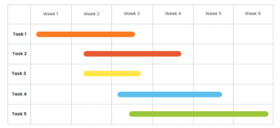

# Módulo: Diagrama de Gantt
{width="400"}
## 📄 Resumen del módulo
El **Diagrama de Gantt** es una herramienta gráfica de gestión de proyectos que permite visualizar el cronograma de las diferentes tareas y actividades a lo largo del tiempo. Representa en el eje horizontal el tiempo y en el eje vertical las tareas planificadas, mostrando de forma clara las fechas de inicio, duración, finalización y las dependencias entre los distintos hitos de un proyecto.

---

## 🎯 ¿Qué creo que aprenderé?
* A planificar y descomponer un proyecto complejo en fases lógicas y tareas manejables.
* A estimar tiempos realistas de ejecución y calcular la ruta crítica de un proyecto.
* A utilizar herramientas digitales de planificación para representar cronogramas y realizar un seguimiento visual del avance temporal.

---

## 💡 ¿Qué espero de este módulo?
Espero mejorar mi capacidad para planificar y llevar el seguimiento a un proyecto informático, pudiendo identificar cuellos de botella y fechas limite, evitando asi retrasos y optimizando la organización de las entregas, algo fundamental para coordinar el desarrollo de aplicaciones web de manera eficiente.

---
