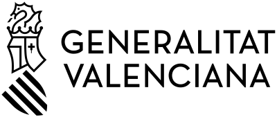

# Módulo: Práctica Final Proyecto Intermodular

## 📄 Resumen del módulo
La **Práctica Final Proyecto Intermodular** representa la síntesis de todos los conocimientos y habilidades adquiridos a lo largo del ciclo formativo. Consiste en la concepción, diseño, desarrollo y documentación de un proyecto web completo y funcional, integrando herramientas de control de versiones, entornos de desarrollo, gestión ágil y despliegue automatizado.

---

## 🎯 ¿Qué creo que aprenderé?
* A integrar de forma práctica las distintas tecnologías y metodologías mas comunes dentro de la comunidad de desarrollo (Markdown, MkDocs, Git, Docker, etc.) para mi futuro desempeño como programador de grandes proyectos.
* A desarrollar la arquitectura e interfaz principal un proyecto.
* A elaborar documentación técnica profesional y estructurada que respalde el código y la arquitectura de la aplicación.

---

## 💡 ¿Qué espero de este módulo?
Espero consolidar mis competencias técnicas creando un proyecto real del que me sienta orgulloso, demostrando capacidad de autonomía, resolución de problemas y calidad en la entrega final del software y su documentación.

---
