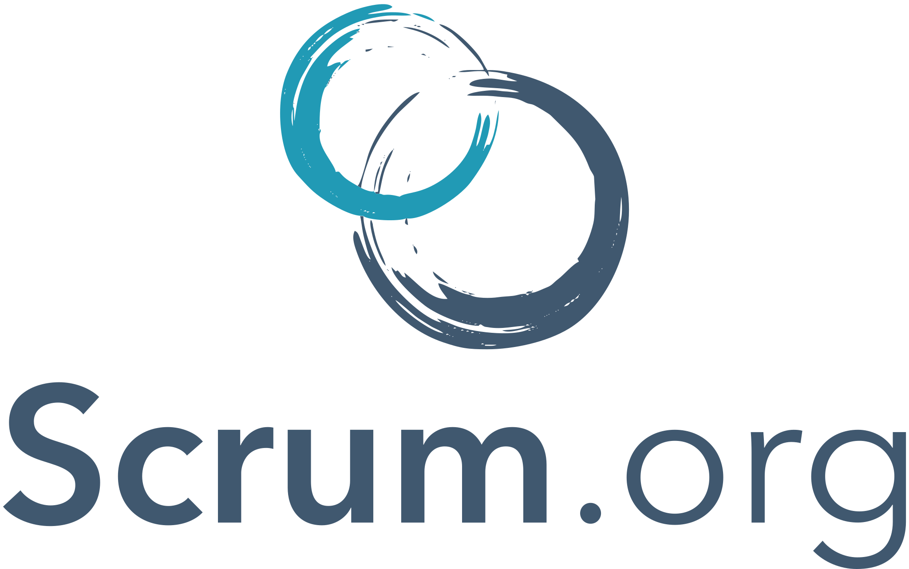

# Módulo: SCRUM
{width="250"}
## 📄 Resumen del módulo
**SCRUM** es un marco de trabajo ágil que facilita el desarrollo, entrega y mantenimiento de productos complejos mediante la colaboración en equipo. Se basa en ciclos de trabajo cortos e iterativos llamados *sprints*, fomentando la inspección continua, la adaptación al cambio, la transparencia y la autoorganización entre los roles clave del equipo.

---

## 🎯 ¿Qué creo que aprenderé?
* A aplicar los pilares fundamentales de la metodología ágil: transparencia, inspección y adaptación.
* A diferenciar y asumir los roles principales del marco SCRUM (Product Owner, Scrum Master y Developers).
* A gestionar ceremonias clave como la planificación del *sprint* (*Sprint Planning*), las reuniones diarias (*Daily Standup*), la revisión (*Sprint Review*) y la retrospectiva (*Retrospective*).

---

## 💡 ¿Qué espero de este módulo?
Espero aprender a trabajar de manera organizada bajo metodologías ágiles realesy los conceptos base de SCRUM, mejorando la comunicación y la capacidad de respuesta ante imprevistos durante el desarrollo colaborativo de proyectos web.

---
