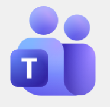

# Microsoft Teams
{width="250"}

## 📄 Resumen del módulo
**Microsoft Teams** es una plataforma de colaboración que reúne chat, reuniones de vídeo, almacenamiento de archivos e integración con aplicaciones en un mismo entorno. Permite organizar canales por equipo o proyecto, facilitar la comunicación síncrona y asíncrona y centralizar el trabajo diario. También puede conectarse con herramientas y automatizaciones, como bots y notificaciones mediante *webhooks*.

---

## 🎯 ¿Qué creo que aprenderé?
* A organizar equipos de trabajo mediante **canales públicos y privados** y gestionar sus permisos.
* A utilizar las opciones de videoconferencia, grabación, transcripción y pizarras colaborativas (*Whiteboard*).
* A integrar herramientas de desarrollo y gestión, como GitHub, Jira y Planner, en los canales de trabajo.
* A conectar bots y alertas automáticas para mejorar la coordinación y el flujo de información.

---

## 💡 ¿Qué espero de este módulo?
Espero aprender a utilizar Teams más allá del chat, como un espacio central para coordinar equipos de desarrollo ágiles. Me interesa especialmente descubrir cómo conectar aplicaciones, bots y notificaciones automáticas para colaborar de forma más organizada.

---
